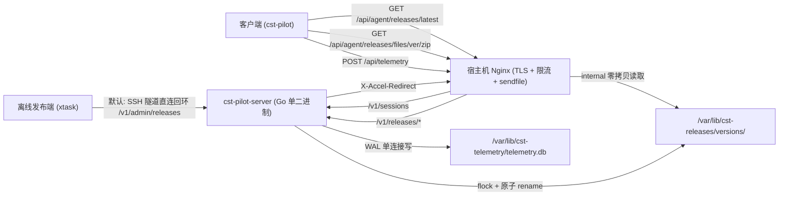
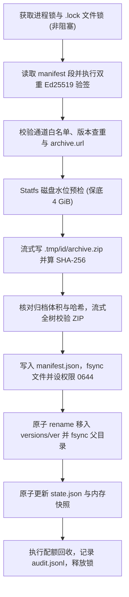
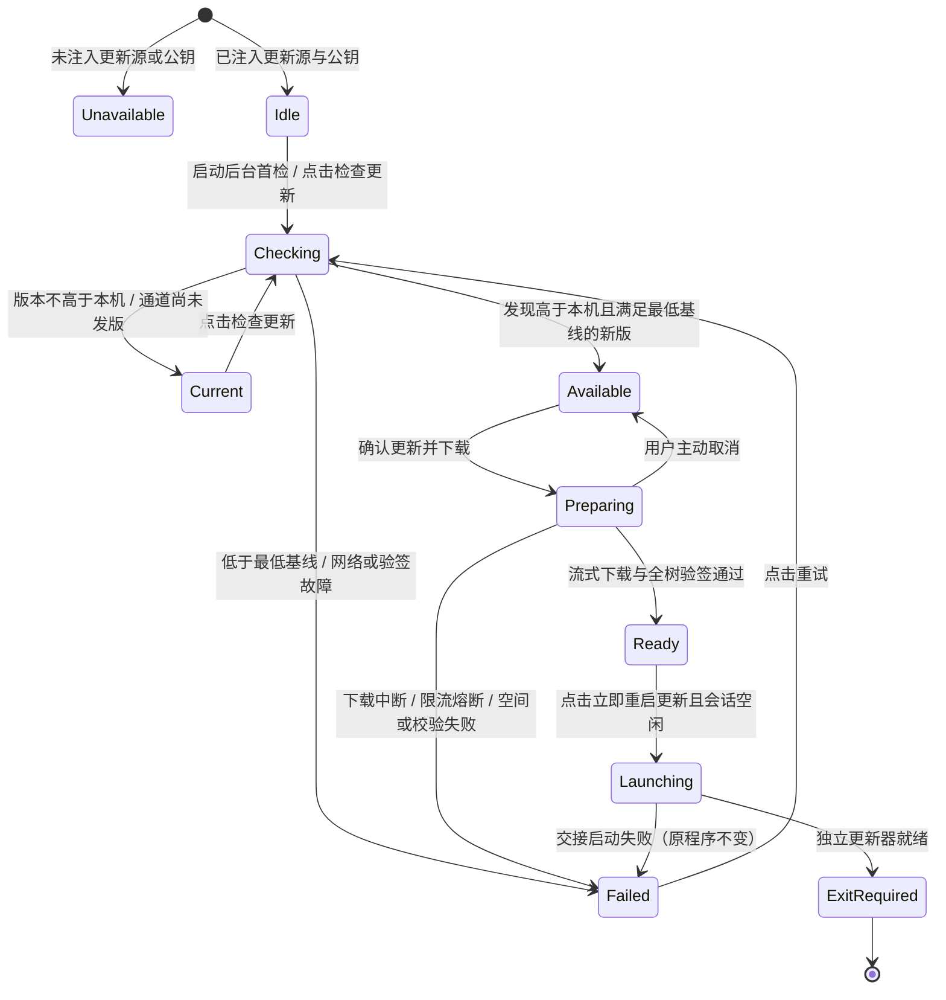

# 客户端发行包托管与分发设计

本文档定义 `cst-pilot-server` 在 CSTOA 实例上托管、校验并分发客户端便携压缩包的整体架构、接口契约与部署规格。接收端程序自身的构建与更新流程见 [release.md](release.md)，当前已上线遥测能力见 [README.md](../README.md)。

## 设计结论

本方案复用现有单二进制 Go 服务，在 CSTOA 实例按配置开关启用发行包管理模块，`timserver_1` 保持纯遥测模式不变。

| 目标维度 | 核心做法 | 量化边界 |
|---|---|---|
| 稳定性 | 上传与 ZIP 校验全程流式处理，不解压落盘。发行存储与遥测 SQLite 物理分离 | 堆内存软上限 48 MiB，磁盘保底余量 4 GiB，版本总占用上限 1 GiB |
| 下载速率 | 生产采用 Nginx `X-Accel-Redirect` 零拷贝直出并关闭 gzip。无 Nginx 时自动降级 Go `http.ServeContent` | 统一返回 `https://www.cstoa.top` 同源 `200 OK`。同城 200 Mbps 下 43 MiB 耗时 2 到 4 秒 |
| 安全性 | 管理接口默认仅回环监听经 SSH 隧道发布，叠加管理令牌与服务端内置 Ed25519 公钥双重验签。Nginx 与 Go 双层限流并配滚动流量熔断 | 服务端不持有私钥。默认小时预算 10 GiB、日预算 30 GiB，已发布版本不可变 |
| 双端兼容 | 未配置 `RELEASE_STORAGE_DIR` 时模块关闭，不建目录且不注册路由。首版在 CSTOA 同时开放 `latest` 与 `beta` 清单入口 | `timserver_1` 容器继续保持 24 MiB GC 软上限与 64 MiB 内存硬限 |

## 运行边界与客户端硬约束

### 宿主机资源与双端兼容

CSTOA 宿主机配备 2 vCPU 与 1.8 GiB 内存，未开 Swap。40 GiB 系统盘当前剩余约 26 GiB，公网出口按流量计费，峰值带宽 200 Mbps。宿主机 Nginx 负责终止 TLS，当前全局 `client_max_body_size` 为 `10m`，裸域以 `301` 跳转到 `www` 域名。

| 部署实例 | 遥测接收 | 发行包分发 | 内存软上限 | 部署形态 |
|---|---|---|---|---|
| CSTOA | 启用 | 启用（配置 `RELEASE_STORAGE_DIR`） | 48 MiB | systemd + 宿主机 Nginx |
| `timserver_1` | 启用 | 关闭（不配置发行变量） | 24 MiB | Docker Compose（容器硬限 64 MiB） |

### 客户端升级协议约束

服务端路由、响应头与校验逻辑对齐主仓库 `cst-pilot` 升级实现（`crates/cst-kit/src/update/` 与 `crates/cst-updater/`）：

| 约束项 | 客户端行为 | 服务端对应要求 |
|---|---|---|
| 信任根与源地址 | 编译期固化 `CST_UPDATE_MANIFEST_URL` 与 32 字节 Base64 `CST_UPDATE_PUBLIC_KEY` | 统一使用 `https://www.cstoa.top`；服务端加载同一份公钥 |
| 传输与重定向 | 强制公共 CA HTTPS、关闭代理、拒绝跨源重定向（裸域跳 `www` 会失败） | 清单与归档均在 `https://www.cstoa.top` 下直接返回 `200 OK`，零跳转 |
| 清单结构 | `SignedManifest` 与 `ReleaseManifest` 均拒绝未知字段（`deny_unknown_fields`） | 服务端原样保存并原样下发签名信封字节，不做二次重序列化 |
| 双重签名 | Ed25519 严格验签 `cst-pilot-release-manifest-v1\n` 与 `cst-pilot-release-sums-v1\n` | 入库前复现完整双重验签，拒绝弱公钥与非规范签名 |
| 体积与清单校验 | 清单上限 8 MiB，归档匹配 `archive.size`，`archive.unpackedSize` 含 `app/SHA256SUMS` 字节数 | 入库前核对归档哈希、解压总字节数与 `app/SHA256SUMS` 逐字节一致 |
| 超时预算 | 清单读取总限时 10 秒；归档建连 10 秒、单块读 30 秒、总下载 600 秒 | 清单从内存快照响应；归档走内核零拷贝发送并精准返回 `Content-Length` |

## 源 URL 定稿清单

所有客户端更新公开路由统一挂在 `https://www.cstoa.top/api/agent/releases` 下。`/api/agent/` 前缀契合 CSTOA 宿主机网关现有路由放行规则，客户端清单与归档保持严格同源，无裸域跳 `www` 或跨主机重定向。

| 用途 | 完整 URL 或模板 | 适用对象与备注 |
|---|---|---|
| 正式通道清单（`stable`） | `https://www.cstoa.top/api/agent/releases/latest` | 正式构建编译期注入 `CST_UPDATE_MANIFEST_URL` |
| 内测通道清单（`beta`） | `https://www.cstoa.top/api/agent/releases/beta` | 内测构建编译期注入 `CST_UPDATE_MANIFEST_URL`，首版同步开放，未激活版本时返回 `404` |
| 归档下载模板（`archive.url`） | `https://www.cstoa.top/api/agent/releases/files/<version>/cst-pilot-<version>-windows-x64.zip` | 写入签名清单的 `archive.url`，强制校验与 `RELEASE_PUBLIC_BASE_URL` 前缀一致，直出 `200 OK` |
| 本地发布管理入口（默认） | `http://127.0.0.1:18787/v1/admin/releases` | 默认经 SSH 本地端口转发映射宿主机 `127.0.0.1:8787/v1/admin/releases`，不暴露公网管理面 |

## 整体架构与数据流

发行包存储独立落在 `/var/lib/cst-releases`，与遥测库 `/var/lib/cst-telemetry/telemetry.db` 分开读写。通道指针与当前签名清单在内存中保存为不可变快照，客户端请求更新清单时不触碰磁盘与 SQLite。



### 核心隔离决策

1. **元数据不进遥测库**：发行状态保存在 `/var/lib/cst-releases/state.json`，经临时文件 `fsync` 后原子替换。遥测每日汇总、保留期清理与 SQLite 备份不会阻塞发版或下载。
2. **清单热路径零磁盘读**：服务启动和每次发布、切换版本后，将激活通道的 `manifest.json` 原始字节、SHA-256 `ETag` 与版本索引打包为只读结构体，通过 `atomic.Pointer` 原子替换。
3. **路由级读写超时**：取消 `http.Server` 的全局 30 秒读写硬超时，保留 `ReadHeaderTimeout: 10s` 与 `IdleTimeout: 60s`，在路由中间件中通过 `http.ResponseController` 按接口类型分别施加截止时间。

## 稳定性设计

### 流式上传与零落盘解压校验

单份安装包体积在 43 到 60 MiB 之间。无 Swap 环境下，任何整包读入内存或整包解压到磁盘的做法都会推高 OOM 与写满系统盘的风险。

上传接口要求 `multipart/form-data` 请求体严格按以下顺序发送两个字段，服务端通过 `r.MultipartReader()` 顺序流式读取，不调用 `ParseMultipartForm`：

1. **第一段 `manifest`**：限制读取上限 8 MiB。服务端立即执行双重 Ed25519 验签与字段边界检查，同时核对同源 URL、版本号查重与磁盘剩余空间。任一校验失败直接返回错误并终止读取，跳过后续压缩包传输。
2. **第二段 `archive`**：从 `sync.Pool` 取出 32 KiB 固定缓冲区，通过 `io.CopyBuffer` 同步写入临时文件与 SHA-256 哈希器，同时用 `io.LimitReader` 限制字节上限为 `min(manifest.archive.size, RELEASE_MAX_ARCHIVE_BYTES) + 1`。流结束时核对实际字节数和 SHA-256 是否与签名清单一致。
3. **磁盘就地流式核验 ZIP**：对落盘后的临时 ZIP 执行 `fsync`，随后用 `archive/zip.NewReader` 直接以 `ReaderAt` 方式打开临时文件，不把压缩包载入内存，也不解压写出到磁盘。校验流程复现客户端全部红线：
   - 解析 EOCD 与 ZIP64 边界，要求单盘归档。条目总数不超过 200,000，中央目录不超过 64 MiB。
   - 检查每个条目为合法 UTF-8，顶层目录仅为 `cst-pilot/`。拒绝越界路径（含 `..` 与反斜杠）、控制字符、Windows 保留设备名及 UTF-16 超长路径。同时拒绝加密条目、符号链接、特殊 Unix 文件模式以及白名单之外的扩展字段（仅允许 `0x0001` / `0x5455` / `0x7875` / `0x000a`）。
   - 检查归档内无重复路径与大小写冲突（含祖先目录），拒绝已退役组件路径 `wiztree` 与 `app/tools/wiztree`。
   - 对每个普通文件用 32 KiB 缓冲区边解压边计算 SHA-256 并丢弃明文输出。验证 `app/SHA256SUMS` 与 `manifest.sha256Sums` 逐字节相等，验证其余程序区文件集合与 `sums` 精确一致且哈希匹配，验证所有文件（含 `app/SHA256SUMS`）解压字节总和严格等于 `manifest.archive.unpackedSize`。
   - 校验必需文件齐备（三支主程序、`VERSION`、`app/BUILD-INFO.json`、随包字体与默认配置），核对 `VERSION` 和 `app/BUILD-INFO.json` 中的版本号与清单一致。

### 目录布局与原子状态机

```text
/var/lib/cst-releases/
├── .lock                                    # 0600 进程间独占发布锁 (flock)
├── .tmp/                                    # 0700 未完成上传临时区，Nginx 不可访问
├── state.json                               # 0600 通道指针与已入库版本索引
├── audit.jsonl                              # 0600 发布、切换、删除与回收审计日志
└── versions/                                # 0755 已校验不可变版本库，供 Nginx 只读分发
    └── v0.9.6/                              # 0755 单版本只读目录
        ├── manifest.json                    # 0644 原始签名信封字节
        └── cst-pilot-v0.9.6-windows-x64.zip # 0644 发行压缩包
```

发布执行固定状态机，任意一步出错立即清理 `.tmp/<upload-id>` 并释放锁，不留半成品状态：



磁盘空间水位预检在接收压缩包之前执行：

```text
requiredFree = max(RELEASE_MIN_FREE_BYTES, archive.size * 2 + 256 MiB)
```

默认 `RELEASE_MIN_FREE_BYTES` 为 `4 GiB`。系统盘可用空间低于 `requiredFree` 时直接返回 `507 Insufficient Storage`，保证宿主机 OA 服务、遥测数据库、系统日志与每日备份空间不受影响。

### 崩溃自愈

服务每次启动加载发行模块时自动执行一致性恢复：

1. 获取 `.lock` 后清空 `.tmp/` 下全部残留目录与临时文件。
2. 读取 `state.json`；若发现 `versions/` 中存在未登记在 `state.json` 的孤儿版本目录（对应目录已移入但元数据未落盘即断电的场景），记录告警并删除该孤儿目录，等待发布端重试。
3. 核对 `state.json` 中记录的每个版本目录：确认 `manifest.json` 存在、通过公钥验签，且归档文件实际体积与清单声明一致。激活通道指向的版本若受损，服务在启动阶段直接报错退出，防止对外吐出损坏链接。

### 历史版本配额与回收

针对 26 GiB 剩余磁盘，采用条数与总占用双重配额：

| 参数 | 默认值 | 说明 |
|---|---|---|
| `RELEASE_KEEP_COUNT` | `5` | 最多保留的已入库版本数量 |
| `RELEASE_MAX_TOTAL_BYTES` | `1073741824`（1 GiB） | `versions/` 目录总占用上限 |
| 保护集合 | `stable` 激活版、`beta` 激活版、`previousStable` | 保护集合内版本永不自动回收，保证随时一键回滚 |

每次发布完成并落盘新版本后执行一次回收。版本数超过上限或总体积超过上限时，按发布时间从旧到新挑选不在保护集合中的版本：先原子更新 `state.json` 摘除记录并刷新内存快照，再执行 `os.RemoveAll` 删除目录。在 Linux 文件系统下，正在被 Nginx `sendfile` 读取的文件被取消链接后，已有下载连接继续完成传输，空间在最后一个文件描述符关闭后自动回收。

### 遥测与大包隔离

| 隔离维度 | 遥测接口 (`/v1/sessions`、`/healthz`) | 清单接口 (`/v1/releases/channels/*`) | 归档下载 (`/v1/releases/files/*`) | 管理上传 (`POST /v1/admin/releases`) |
|---|---|---|---|---|
| 读超时 | 30 秒 | 10 秒 | 10 秒 | 总限时 10 分钟，单次读进展限时 30 秒 |
| 写超时 | 30 秒 | 15 秒 | 卸载模式 15 秒；直出模式总限时 10 分钟、单块写进展限时 30 秒 | 30 秒 |
| 并发限制 | 现有安装与 IP 限流 | 内存只读无锁 | 卸载模式仅耗微秒鉴权；直出模式并发信号量上限 16 | 独占锁并发为 1，并发冲突返回 409 |
| 内存与存储 | 独立 SQLite 文件 | 内存原子快照 | 内核页缓存零拷贝 | 32 KiB 固定流式缓冲，独立目录 |

## 下载速率与部署规格

### 双模式分发链路

服务端通过 `RELEASE_ACCEL_PREFIX` 环境变量在两种分发模式间切换，对外 HTTP 协议完全一致：

| 模式 | 触发条件 | 工作流程 | 适用环境 |
|---|---|---|---|
| Nginx 内部加速（推荐） | `RELEASE_ACCEL_PREFIX=/_internal/cst-releases` | Go 查内存索引完成安全校验、限流与流量记账后，返回空体与 `X-Accel-Redirect` 头，由 Nginx 以内核 `sendfile` 从磁盘直出 | CSTOA 生产环境 |
| Go 原生直出 | `RELEASE_ACCEL_PREFIX` 为空 | Go 以只读打开归档文件，调用 `http.ServeContent` 输出（Linux 下自动走内核 `sendfile`，原生支持 `ETag` 与 `Range`） | 本地开发、集成测试、无 Nginx 环境 |

在 CSTOA 生产模式下，客户端收到来自 `https://www.cstoa.top` 的 `200 OK` 响应与精确 `Content-Length`。Nginx 内部目录强制关闭 `gzip` 避免对已压缩 ZIP 二次压缩耗尽 2 vCPU，同时热点归档文件自然驻留 Linux 内核 Page Cache，多人并发下载时 Go 进程堆内存与 CPU 几乎零增长。按广州同城 200 Mbps 峰值测算，43 MiB 归档传输耗时约 2 到 4 秒。

### HTTP 缓存与响应头规格

| 路由 | 状态码 | 关键响应头 |
|---|---|---|
| 清单下载 (`GET`/`HEAD`) | `200 OK` / `304 Not Modified` | `Content-Type: application/json; charset=utf-8`、`ETag: "<manifest-sha256>"`、`Cache-Control: no-cache`、`X-Content-Type-Options: nosniff` |
| 归档下载 (`GET`/`HEAD`) | `200 OK` / `206 Partial Content` / `304 Not Modified` | `Content-Type: application/zip`、`Content-Length: <size>`、`Content-Disposition: attachment; filename="<file>"`、`ETag: "<archive-sha256>"`、`Cache-Control: public, max-age=31536000, immutable`、`X-Content-Type-Options: nosniff` |

说明：客户端在线升级不发送 `Range` 头，固定收到 `200 OK` 全量响应；浏览器或手动下载工具可正常使用 `Range` 断点续传与 `If-None-Match` 缓存验证。

### CSTOA Nginx 配置模板

以下配置追加到 `deploy/cstoa/` 作为参考模板（实机变更需另行审批执行）。所有限流区定义放在 `http {}` 块，路由块放在 `https://www.cstoa.top` 对应的 `server {}` 块中，裸域仍维持跳 `www`，客户端与清单只引用 `www.cstoa.top`。

```nginx
# http {} 块内限流与并发区定义
limit_conn_zone $binary_remote_addr zone=cst_rel_ip_conn:10m;
limit_conn_zone $server_name        zone=cst_rel_total_conn:1m;
limit_req_zone  $binary_remote_addr zone=cst_rel_manifest_req:10m rate=30r/m;
limit_req_zone  $binary_remote_addr zone=cst_rel_file_req:10m     rate=12r/m;
limit_req_zone  $binary_remote_addr zone=cst_rel_admin_req:5m     rate=6r/m;
```

```nginx
# https://www.cstoa.top 的 server {} 块内新增路由

# 限流结构化 JSON 响应（供 limit_req / limit_conn 触发 429 时返回标准信封）
location @cst_rel_429 {
    default_type application/json;
    add_header Retry-After "10" always;
    add_header X-Content-Type-Options "nosniff" always;
    return 429 '{"error":{"code":"rate_limited","message":"too many requests"}}';
}

# 1. stable 通道清单（客户端默认 CST_UPDATE_MANIFEST_URL）
location = /api/agent/releases/latest {
    limit_req zone=cst_rel_manifest_req burst=20 nodelay;
    limit_req_status 429;
    error_page 429 = @cst_rel_429;
    proxy_pass http://127.0.0.1:8787/v1/releases/channels/stable/latest;
    proxy_http_version 1.1;
    proxy_set_header Host $host;
    proxy_set_header X-Real-IP $remote_addr;
    proxy_connect_timeout 5s;
    proxy_read_timeout 15s;
}

# 2. beta 通道清单（供内测构建使用）
location = /api/agent/releases/beta {
    limit_req zone=cst_rel_manifest_req burst=20 nodelay;
    limit_req_status 429;
    error_page 429 = @cst_rel_429;
    proxy_pass http://127.0.0.1:8787/v1/releases/channels/beta/latest;
    proxy_http_version 1.1;
    proxy_set_header Host $host;
    proxy_set_header X-Real-IP $remote_addr;
    proxy_connect_timeout 5s;
    proxy_read_timeout 15s;
}

# 3. 归档下载入口（Go 校验限流后下发 X-Accel-Redirect）
location ^~ /api/agent/releases/files/ {
    limit_conn cst_rel_ip_conn 4;
    limit_conn cst_rel_total_conn 20;
    limit_conn_status 429;
    limit_req zone=cst_rel_file_req burst=6 nodelay;
    limit_req_status 429;
    error_page 429 = @cst_rel_429;

    proxy_pass http://127.0.0.1:8787/v1/releases/files/;
    proxy_http_version 1.1;
    proxy_set_header Host $host;
    proxy_set_header X-Real-IP $remote_addr;
    proxy_connect_timeout 5s;
    proxy_read_timeout 15s;
}

# 4. 内部只读零拷贝版本目录（仅暴露 versions/，禁用符号链接，公网直访固定返回 404）
location ^~ /_internal/cst-releases/ {
    internal;
    alias /var/lib/cst-releases/versions/;
    disable_symlinks on;
    sendfile on;
    sendfile_max_chunk 1m;
    tcp_nopush on;
    tcp_nodelay on;
    gzip off;
    etag off;
    add_header X-Content-Type-Options "nosniff" always;
    add_header ETag $upstream_http_etag always;
    # 常规压缩包 43 到 60 MiB 全程满速跑完；仅对超出 65 MiB 的异常连接降速
    limit_rate_after 65m;
    limit_rate 2m;
    send_timeout 60s;
}

# 5. 可选公网管理入口（默认推荐走 SSH 隧道访问 127.0.0.1:8787，按需再开放）
# location ^~ /api/agent/releases/admin/ {
#     limit_req zone=cst_rel_admin_req burst=5 nodelay;
#     limit_req_status 429;
#     client_max_body_size 260m;
#     proxy_request_buffering off;
#     proxy_buffering off;
#     proxy_pass http://127.0.0.1:8787/v1/admin/releases/;
#     proxy_http_version 1.1;
#     proxy_set_header Host $host;
#     proxy_set_header X-Real-IP $remote_addr;
#     proxy_connect_timeout 10s;
#     proxy_send_timeout 600s;
#     proxy_read_timeout 600s;
# }
```

### systemd 服务变更规格

`deploy/cstoa/cst-telemetry.service` 仅需新增发行目录写权限并维持原有最小权限沙箱：

1. `ReadWritePaths=/var/lib/cst-telemetry -/var/lib/cst-releases`（前导 `-` 保证发行目录尚未创建时不影响纯遥测启动）
2. 启用 Nginx 加速时在 `telemetry.env` 中同步设置 `RELEASE_TRUST_PROXY=1` 与 `RELEASE_ACCEL_PREFIX=/_internal/cst-releases`。目录 `/var/lib/cst-releases` 归属 `csttele:csttele`，权限 `0755`，其下 `.tmp/`、`state.json`、`.lock`、`audit.jsonl` 由 Go 进程显式设为 `0700` 或 `0600`，`versions/` 与已发布文件设为 `0755` / `0644`，Nginx 仅能只读 `versions/` 且禁用符号链接。
3. 现有 `NoNewPrivileges=true`、`ProtectSystem=strict`、`ProtectHome=true`、`PrivateTmp=true` 全部保留。

### TLS 证书到期监控与续签检查项

客户端硬性校验公共 CA 证书链，证书过期会导致全员升级检查失败。CSTOA 宿主机需落实现场检查项：

| 检查项 | 判据 | 动作 |
|---|---|---|
| 续签定时任务 | `certbot` 或 `acme.sh` 定时任务处于启用状态，续签钩子包含 `nginx -t && systemctl reload nginx` | 每月检查一次定时任务日志 |
| 证书剩余有效期 | 探测 `www.cstoa.top:443` 证书剩余天数，低于 30 天执行续签，低于 14 天触发人工告警 | 接入巡检脚本每日检查 |
| 完整链与域名覆盖 | 证书 SAN 覆盖 `www.cstoa.top`，返回完整中间证书链 | 每次续签后用 `openssl s_client` 验证 |

## 安全性设计

### 双重防线发布鉴权

服务端对上传与切换操作实行两层独立验证，管理凭据与内容信任根分离：

1. **第一层：管理凭据鉴权**
   - 请求必须携带 `Authorization: Bearer <RELEASE_ADMIN_TOKEN>`。
   - `RELEASE_ADMIN_TOKEN` 独立于 `OA_SERVICE_TOKEN`，启动时强制校验长度不少于 32 字节。
   - 使用 `crypto/subtle.ConstantTimeCompare` 比对令牌，拒绝空令牌与明文日志打印。
   - 按来源 IP 统计鉴权失败次数，10 分钟内失败达到 10 次即返回 `429 Too Many Requests` 并锁定冷却窗口，内存计数表硬上限 2048 项。
   - 写操作接口（上传、切换、删除、回收）仅在 `RELEASE_ADMIN_TOKEN` 与 `RELEASE_PUBLIC_KEY` 同时配置时开放；缺失管理令牌时服务自动以只读模式运行。
2. **第二层：零信任密码学验签**
   - 服务端仅通过 `RELEASE_PUBLIC_KEY` 加载 32 字节官方 Ed25519 公钥（与客户端编译期公钥同源），不持有也不接触私钥。
   - 上传入库前，Go 服务端执行与 `cst-updater` 等价的严格双重验签（拒绝弱公钥、校验 `cst-pilot-release-manifest-v1\n` 与 `cst-pilot-release-sums-v1\n`、校验 `archive.url` 精确匹配 `<RELEASE_PUBLIC_BASE_URL>/files/<version>/cst-pilot-<version>-windows-x64.zip`、校验 ZIP 全树内容）。
   - 通道切换与回滚接口仅允许切换到已入库版本，且切换前重新核验磁盘上 `manifest.json` 签名与 `archive.zip` 体积。

即使管理令牌泄露或管理入口被攻破，攻击者也无法向线上投毒或下发未经离线私钥签名的压缩包。

### 防刷流与按量带宽保护

按量计费 200 Mbps 出口在满载状态下每小时消耗约 90 GB 流量。系统在网关层与应用层叠加三道防线：

| 防线层级 | 控制项 | 默认参数 | 超限响应 |
|---|---|---|---|
| Nginx 网关层 | 单 IP 归档下载并发 | 4 并发（兼容校园网 NAT 出口） | `429` |
| Nginx 网关层 | 全局归档下载并发 | 20 并发 | `429` |
| Nginx 网关层 | 归档下载请求速率 | 12 次/分钟/IP，突发 6 | `429` |
| Go 应用层 | 单 IP 高频拉包保护 | 10 分钟内同一 IP 最多放行 5 次归档下载 | `429` + `Retry-After` |
| Go 应用层 | 滚动小时与日流量预算熔断 | 1 小时上限 `10 GiB`；24 小时上限 `30 GiB` | `503` + `Retry-After`（仅熔断归档，清单保持可读） |

真实客户端 IP 提取遵循最小信任原则：仅当配置 `RELEASE_TRUST_PROXY=1` 且 TCP 对端为本机回环地址时，才读取 Nginx 覆盖写入的 `X-Real-IP`；其余场景一律使用 `r.RemoteAddr`，防止伪造代理头绕过限流。

### 路径白名单与版本不可变

1. **通道白名单**：仅接受 `stable` 与 `beta`，其他通道名返回 `404`。
2. **版本号白名单**：正则匹配 `^v?[0-9]+\.[0-9]+\.[0-9]+(-[0-9A-Za-z.-]+)?$`，长度不超过 64 字节。
3. **索引寻址**：下载与管理操作统一从内存快照或 `state.json` 查表获取版本记录与规范文件名，不直接把请求路径拼接进文件系统路径。
4. **版本不可变**：已存在版本号禁止覆盖，重复上传同一版本返回 `409 Conflict`（错误码 `version_already_exists`）。需要重新打包时必须递增版本号或预发布标识。
5. **符号链接防护**：扫描与清理发行目录时使用 `os.Lstat` 校验，发现符号链接直接拒绝操作并记录告警。

## 端到端连接状态机与报错设计

### 客户端连接与升级状态机

当前主仓客户端已在桌面端设置页「常规 -> 软件更新」（`crates/cst-desktop/src/settings/general_tab.rs` 与 `update_dialog.rs`）及 TUI `/update` 命令中接入 `UpdatePhaseDto` 状态模型，Web 设置页（`settings-general.tsx`）暂未挂载软件更新行。前后端对齐的端到端状态流转如下：



设置页「常规 -> 软件更新」全量状态呈现规范：

| 阶段 (`UpdatePhaseDto`) | 触发条件 | 界面标题 / 徽章 | 次级详情展示 | 可执行动作 |
|---|---|---|---|---|
| `Unavailable` | 编译期缺少 `CST_UPDATE_MANIFEST_URL` 或 `CST_UPDATE_PUBLIC_KEY` | 未启用自动更新 | 未配置编译期更新源 | 只读徽章「未启用」 |
| `Idle` | 已启用但尚未发起首检 | 检查签名更新 | 手动检查在线升级包 | 「检查更新」 |
| `Checking` | 启动后台首检或用户手动点击检查 | 正在检查更新… | 正在连接更新源并核验签名 | 进度指示 + 「取消」 |
| `Current` | 远端版本不高于本机版本 | 当前已是最新版本 | 空（通道返回 `channel_empty` 时显示「暂未发布在线更新」） | 「检查更新」 |
| `Available` | 远端版本高于本机且本机不低于 `minUpgradableVersion` | 发现新版本 `vX.Y.Z` | 可下载并重启升级 | 「查看更新」弹出更新说明与「更新并重启」 |
| `Preparing` | 正在流式下载归档并执行全树验签 | 正在下载 `vX.Y.Z` | 百分比与已下载 / 总大小（MB） | 进度条 + 「稍后」（后台继续） / 「取消」 |
| `Ready` | 压缩包下载、解压与双重验签全部通过 | 更新包已就绪 | 校验通过，重启后完成升级 | 「重启更新」（会话忙碌时提示先结束当前对话） |
| `Launching` / `ExitRequired` | 已交接独立更新器，等待宿主退出替换 | 正在重启完成更新… | 窗口即将自动重启并替换组件 | 锁屏等待，禁用取消 |
| `Failed`（可重试） | 网络故障、超时、限流、熔断、磁盘不足或校验失败 | 更新检查失败 / 下载更新失败 | 红字展示分类后的短提示原因（见下表） | 「重试」（限流/熔断附带冷却提示） |
| `Failed`（需手动换包） | 本机版本低于清单 `minUpgradableVersion` | 需下载完整发行包 | 当前版本过旧，无法原位升级，请重新下载完整便携包 | 保留状态提示，不引导无效原位重试 |

首检静默原则：应用启动触发的自动首检不弹出模态框打扰用户。首检遇到通道暂未发版（`404 channel_empty`）时，归入温和态提示「暂未发布在线更新」，不显示红色故障告警；遇到网络离线或临时超限时仅在设置页记录失败详情，由用户按需点击重试。

### 服务端错误码与客户端报错映射

服务端所有公开接口失败响应统一输出 JSON 信封 `{"error":{"code":"...","message":"..."}}`，`429` 与 `503` 响应必须附带 `Retry-After`（整数秒）。

| 场景类别 | 服务端响应 (`HTTP` / `error.code` / 头) | 客户端日志记录（脱敏） | 界面短提示文案（用户可见） | 建议动作 |
|---|---|---|---|---|
| 本机离线或 DNS 失败 | 无响应（客户端建连失败） | `phase` + DNS/连接错误类别（不含代理凭据） | 无法连接更新服务器，请检查网络连接后重试 | 点击重试 |
| 请求或下载超时 | 无完整响应（建连 10s / 清单 10s / 读块 30s / 总计 600s） | `phase` + 超时阶段与已收字节数 | 连接更新服务器超时，请稍后重试 | 点击重试 |
| 校园网门户劫持或跨源跳转 | 非同源 `301`/`302`（或返回 HTML 门户页） | 触发同源重定向策略拒绝与响应状态码 | 网络可能存在认证拦截，请先完成校园网登录后重试 | 完成认证后重试 |
| TLS 证书校验失败 | TLS 握手失败 | 证书校验错误摘要（不含原始凭据） | 安全连接建立失败，请检查本机系统时间或网络环境 | 校准系统时间后重试 |
| 通道尚未发布版本 | `404` / `channel_empty` | `channel` + `404 channel_empty` | 暂未发布在线更新 | 保持当前版本，稍后再查 |
| 旧版归档已被回收 | `404` / `release_not_found` | 请求版本 + `404 release_not_found` | 更新版本已变更，请重新检查更新 | 点击重新检查 |
| 单 IP 并发或高频限流 | `429` / `rate_limited` + `Retry-After` | `status=429` + `retry_after` | 请求过于频繁，请于 `<N>` 秒后重试 | 等待冷却后重试 |
| 小时或日流量预算熔断 | `503` / `bandwidth_budget_exceeded` + `Retry-After` | `status=503` + `code` + `retry_after` | 当前下载人数较多，更新通道暂歇，请稍后重试 | 稍后重试或线下拷贝包 |
| 服务端维护或网关异常 | `500`/`502`/`503`/`504` | HTTP 状态码与服务端 `error.code` | 更新服务暂时不可用，请稍后重试 | 稍后重试 |
| 低于最低可升级版本 | `200 OK`（清单验签通过但 `current < minUpgradableVersion`） | `current_version` 与 `min_upgradable_version` | 当前版本过旧，请前往下载最新完整便携包 | 手动下载完整包 |
| 磁盘空间不足 | 无（客户端本机 `Stage::create` 预检拦截） | 所需字节与所在卷可用字节 | 工具包所在磁盘空间不足，请清理后重试 | 清理磁盘后重试 |
| 验签或哈希校验失败 | `200 OK`（Ed25519 签名、归档或全树 SHA-256 不匹配） | 失败阶段（清单验签 / 归档哈希 / 全树校验） | 更新包安全校验未通过，已停止升级，当前程序不受影响 | 联系维护者核查，切勿强行安装 |

### 主仓 `cst-kit` 报错透传对齐点

主仓现有 `crates/cst-kit/src/update/network.rs` 与 `service.rs` 当前会在非 `200 OK` 与 `run_check_locked` / `prepare_locked` 中合并吞掉底层故障原因。联调时需在主仓做最小配套改动：

1. `network.rs` 遇到非 `200` 响应时解析 `status`、`Retry-After` 与有界错误体（上限 4 KiB）中的 `error.code`，向上返回结构化 `UpdateError` 枚举（覆盖网络、超时、跨源劫持、TLS、限流、熔断、通道为空、归档失效、空间不足、版本过旧、验签失败）。
2. `service.rs` 依据 `UpdateError` 写入对应的中文短提示到 `UpdateStatus.message`（不再用 `Err(_)` 统一覆盖），并将 `404 channel_empty` 映射为温和的 `Phase::Current`（附「暂未发布在线更新」提示），其余故障进入 `Phase::Failed` 由设置页红字展示。

## 接口、环境变量与 CLI 规格

### HTTP 路由定义

公开路由与管理路由统一沿用现有错误响应结构 `{"error":{"code":"...","message":"..."}}`。

| 路由 | 方法 | 鉴权 | 用途 | 典型状态码 |
|---|---|---|---|---|
| `/v1/releases/channels/{channel}/latest` | `GET` / `HEAD` | 公开 | 返回指定通道当前已签名清单原始字节 | `200 / 304 / 404` |
| `/v1/releases/files/{version}/{filename}` | `GET` / `HEAD` | 公开 | 校验版本与限流后分发归档（`X-Accel-Redirect` 或 `ServeContent`） | `200 / 206 / 304 / 404 / 429 / 503` |
| `/v1/admin/releases` | `GET` | 管理令牌 | 查询通道指针、版本库存、磁盘水位与流量预算 | `200 / 401 / 429` |
| `/v1/admin/releases` | `POST` | 管理令牌 + Ed25519 双验签 | 流式上传新版本（参数 `?channel=stable&activate=true`） | `201 / 400 / 401 / 409 / 413 / 422 / 507` |
| `/v1/admin/releases/channels/{channel}` | `PUT` | 管理令牌 + 磁盘复验 | 原子切换或回滚通道激活版本（正文 `{"version":"v0.9.5"}`） | `200 / 400 / 401 / 404 / 409` |
| `/v1/admin/releases/versions/{version}` | `DELETE` | 管理令牌 | 删除指定未激活历史版本（激活版本返回 `409`） | `200 / 401 / 404 / 409` |
| `/v1/admin/releases/gc` | `POST` | 管理令牌 | 手动触发一次配额清理 | `200 / 401 / 409` |

`GET /healthz` 保持原有 `ok`、`sessions`、`version`、`builtAt` 字段兼容；启用发行模块后额外附带只读摘要：

```json
{
  "ok": true,
  "sessions": 128,
  "version": "c56eb44",
  "builtAt": "2026-11-26T09:00:00Z",
  "releases": {
    "enabled": true,
    "stableVersion": "v0.9.6",
    "betaVersion": "",
    "storedVersions": 3,
    "freeBytes": 24159191040,
    "budgetTripped": false
  }
}
```

### 环境变量配置表

| 环境变量 | 必填（启用时） | 默认值 | 说明 |
|---|---|---|---|
| `RELEASE_STORAGE_DIR` | 是（开关） | 空（关闭模块） | 发行包根目录，CSTOA 设为 `/var/lib/cst-releases` |
| `RELEASE_PUBLIC_KEY` | 是 | 空 | 官方 Ed25519 公钥（32 字节 Standard Base64） |
| `RELEASE_PUBLIC_BASE_URL` | 是 | 空 | 公开下载基址，例如 `https://www.cstoa.top/api/agent/releases` |
| `RELEASE_ADMIN_TOKEN` | 写接口必填 | 空（只读） | 管理接口 Bearer 令牌，长度不少于 32 字节 |
| `RELEASE_ACCEL_PREFIX` | 否 | 空（Go 直出） | Nginx 内部加速前缀，CSTOA 设为 `/_internal/cst-releases` |
| `RELEASE_TRUST_PROXY` | 否 | `0` | 设为 `1` 时仅信任回环代理传入的 `X-Real-IP` |
| `RELEASE_MAX_ARCHIVE_BYTES` | 否 | `268435456`（256 MiB） | 单包上传与分发体积硬上限 |
| `RELEASE_MIN_FREE_BYTES` | 否 | `4294967296`（4 GiB） | 磁盘最低保留安全余量 |
| `RELEASE_KEEP_COUNT` | 否 | `5` | 历史版本默认保留数量 |
| `RELEASE_MAX_TOTAL_BYTES` | 否 | `1073741824`（1 GiB） | 历史版本总磁盘占用硬上限 |
| `RELEASE_HOURLY_BUDGET_BYTES` | 否 | `10737418240`（10 GiB） | 滚动 1 小时归档分发流量预算 |
| `RELEASE_DAILY_BUDGET_BYTES` | 否 | `32212254720`（30 GiB） | 滚动 24 小时归档分发流量预算 |
| `RELEASE_MAX_DIRECT_DOWNLOADS` | 否 | `16` | Go 原生直出模式最大并发下载连接数 |

### 服务端 CLI 管理子命令

在现有 `serve`、`version`、`export-csv`、`delete`、`rollup` 基础上新增 `release` 子命令族：

| 命令 | 默认行为 | 说明 |
|---|---|---|
| `telemetry-receiver release list` | 请求本机管理接口 | 展示通道指针、版本库存、磁盘与流量预算 |
| `telemetry-receiver release publish --manifest <f> --archive <f> [--channel stable] [--no-activate]` | 请求本机管理接口 | 本机流式推送并入库，常驻服务内存快照即时生效 |
| `telemetry-receiver release activate --channel stable --version <v>` | 请求本机管理接口 | 一键切换或回滚版本 |
| `telemetry-receiver release gc` | 请求本机管理接口 | 触发历史归档回收 |

服务停机时，上述子命令支持附加 `--offline` 直接读写 `RELEASE_STORAGE_DIR`（受 `.lock` 保护），避免在线修改磁盘后出现服务内存快照滞后。

## 与主仓 `cst-pilot` 的接口对接契约

主仓 `crates/xtask` 当前包含 `dist` 与 `verify-tree` 子命令。为打通从打包、离线签名到服务端入库的完整链路，主仓需按以下契约补充 `sign-release` 与 `publish-release`：

### 1. `xtask sign-release`

输入 `xtask dist` 产出的干净目录与压缩包，使用离线 Ed25519 私钥生成签名清单 `manifest.signed.json`。

| 参数或字段 | 契约要求 |
|---|---|
| 输入参数 | `--dist-dir <dir>`、`--zip <path>`、`--version <vX.Y.Z>`、`--min-upgradable <vX.Y.Z>`、`--base-url https://www.cstoa.top/api/agent/releases`、`--notes-file <md>`、`--out <manifest.signed.json>`，私钥通过 `--private-key-file` 或环境变量传入 |
| `archive.url` | 严格拼接为 `<base-url>/files/<version>/cst-pilot-<version>-windows-x64.zip` |
| `archive.unpackedSize` | 等于压缩包内全部普通文件解压字节之和，包含 `app/SHA256SUMS` 自身字节数 |
| 签名步骤 | 先对 `cst-pilot-release-sums-v1\n` 拼接 `app/SHA256SUMS` 原文签名得到 `sha256Signature`；序列化 `ReleaseManifest` 为紧凑 UTF-8 JSON 字符串作 `payload`；再对 `cst-pilot-release-manifest-v1\n` 拼接 `payload` 字节签名得到 `signature` |
| 本地自检 | 产出后立即调用 `cst_updater::manifest::ReleaseKey::verify` 与 `VerifiedPackage::stage_from_archive_bytes` 完成离线闭环验签 |

签名清单顶层结构示例：

```json
{
  "payload": "{\"schemaVersion\":1,\"platform\":\"windows-x86_64\",\"version\":\"v0.9.6\",\"builtAt\":\"2026-11-26T09:00:00Z\",\"minUpgradableVersion\":\"v0.9.0\",\"releaseNotes\":\"...\",\"archive\":{\"url\":\"https://www.cstoa.top/api/agent/releases/files/v0.9.6/cst-pilot-v0.9.6-windows-x64.zip\",\"size\":45123456,\"unpackedSize\":148901234,\"sha256\":\"...\"},\"sha256Sums\":\"...\",\"sha256Signature\":\"...\"}",
  "signature": "<base64-ed25519-signature>"
}
```

### 2. `xtask publish-release`

| 契约项 | 规格 |
|---|---|
| 目标地址 | 默认通过 SSH 隧道指向 `http://127.0.0.1:18787/v1/admin/releases?channel=<ch>&activate=<bool>`，或指向受控 HTTPS 管理入口 |
| 令牌传递 | 从环境变量 `CST_RELEASE_ADMIN_TOKEN` 读取并写入 `Authorization: Bearer` 头，禁止经命令行参数传递 |
| 请求体格式 | `multipart/form-data`，第一段字段名 `manifest`（文件 `manifest.signed.json`），第二段字段名 `archive`（文件 `cst-pilot-<version>-windows-x64.zip`） |
| 发布后验收 | 收到 `201 Created` 后自动请求公开清单 URL（如 `https://www.cstoa.top/api/agent/releases/latest`），用官方公钥复验返回清单的版本与签名，并对 `archive.url` 发送 `HEAD` 核对 `200 OK` 与 `Content-Length` |

### 3. 服务端与客户端校验一致性矩阵

| 校验项 | `cst-updater`（客户端） | `cst-pilot-server`（服务端入库） |
|---|---|---|
| `SignedManifest` 严格字段与 8 MiB 上限 | 校验 | 校验 |
| `MANIFEST_DOMAIN` / `SUMS_DOMAIN` Ed25519 严格验签 | 校验 | 校验 |
| `schemaVersion=1`、`platform=windows-x86_64`、semver、RFC 3339 | 校验 | 校验 |
| `archive.url` 为合法 HTTPS 且匹配本服务规范下载地址 | 校验 HTTPS 与同源 | 校验 HTTPS 与精确前缀文件名 |
| `archive.size` 与 `archive.sha256` | 下载后校验 | 流式落盘同步校验 |
| ZIP EOCD / ZIP64 边界、UTF-8、`cst-pilot/` 顶层、路径红线与扩展头 | 解压时校验 | 落盘后不解压流式校验 |
| `app/SHA256SUMS` 逐字节一致与全树逐文件 SHA-256 | 解压后全树校验 | 流式解压算哈希校验 |
| `archive.unpackedSize`（含 `app/SHA256SUMS`）精确相等 | 解压时校验 | 流式解压累计校验 |
| `VERSION`、`app/BUILD-INFO.json` 与必需文件清单 | 元数据校验 | 流式读取小文件校验 |

## 代码模块拆分与开发实施步骤

### 本仓源码模块拆分

保持本仓扁平单包 `package main`（位于 `src/`）与零 CGO 纯 Go 依赖风格，不引入额外第三方库（磁盘空间检查直接复用 `go.mod` 中已有的 `golang.org/x/sys`）：

| 文件路径 | 变更类型 | 职责 |
|---|---|---|
| `src/release_config.go` | 新增 | 解析与校验全部 `RELEASE_*` 环境变量、解码并验证 Ed25519 公钥（拒绝弱公钥） |
| `src/release_verify.go` | 新增 | 实现 `SignedManifest` / `ReleaseManifest` 严格解析、双重 Ed25519 验签、路径红线与流式 ZIP 全树校验 |
| `src/release_store.go` | 新增 | 目录初始化、`.lock` 文件锁、`state.json` 原子读写、内存只读快照、启动崩溃自愈、历史版本配额回收与 `audit.jsonl` |
| `src/release_fs_unix.go` / `src/release_fs_windows.go` | 新增 | 跨平台磁盘可用空间查询（`unix.Statfs` / Windows API）与文件锁封装 |
| `src/release_limit.go` | 新增 | 滚动 1 小时/24 小时流量预算熔断器、单 IP 高频下载限次、管理鉴权失败限速、受控 `X-Real-IP` 提取 |
| `src/release_http.go` | 新增 | 公开清单路由、归档分发路由（`X-Accel-Redirect` 与 `ServeContent` 双模式）、管理上传/查询/切版/删版/GC 路由 |
| `src/release_cli.go` | 新增 | `release list / publish / activate / gc` CLI 子命令实现（在线本机接口 + `--offline` 离线模式） |
| `src/main.go` | 修改 | 接入发行模块开关初始化、按开关设置 GC 内存软上限（24 MiB / 48 MiB）、注册 `release` 子命令 |
| `src/server.go` | 修改 | 改为路由级 `http.ResponseController` 超时控制、挂载发行路由与 `/healthz` 只读摘要 |
| `src/release_*_test.go` | 新增 | 覆盖双验签、篡改/降级/弱公钥拒绝、ZIP 红线、流式大包内存与哈希、断电自愈、版本不可变、配额回收、双模式下载、限流与熔断、双端关闭隔离 |
| `deploy/cstoa/cst-telemetry.service` | 修改 | `ReadWritePaths` 增加 `/var/lib/cst-releases` |
| `deploy/cstoa/nginx-releases.conf.example` | 新增 | 提供可审阅的 CSTOA Nginx 限流、反代与 `X-Accel-Redirect` 配置模板 |

### 开发与文档衔接步骤

1. **阶段 1（校验与存储内核）**：实现 `release_config.go`、`release_verify.go`、`release_fs_*.go`、`release_store.go`，配齐与 `cst-updater` 一致的测试向量（含合法包、坏签名、弱公钥、`unpackedSize` 不含 `SHA256SUMS` 偏差、路径穿越、大小写冲突、孤儿目录自愈与 GC 保护）。
2. **阶段 2（HTTP 路由、限流与 CLI）**：改造 `server.go` 路由级超时，实现 `release_limit.go`、`release_http.go`、`release_cli.go`，补充 `-race` 并发下载、并发发布冲突、流量熔断、Nginx `X-Accel-Redirect` 与 Go 直出双模式集成测试。
3. **阶段 3（部署模板与文档同步）**：新增 `deploy/cstoa/nginx-releases.conf.example`，更新 `deploy/cstoa/cst-telemetry.service`、`deploy/cstoa/README.md`、`README.md` 与 `doc/release.md`（同步检查 `scripts/deploy.py` 保留 `/var/lib/cst-releases` 与既有配置）。
4. **阶段 4（主仓对接与联合验收）**：在主仓 `cst-pilot` 实现 `xtask sign-release` 与 `xtask publish-release`，同步按「主仓 `cst-kit` 报错透传对齐点」补齐 `network.rs` / `service.rs` 结构化错误映射，在本地隔离目录完成“打包 -> 签名 -> 上传 -> 客户端检查更新 -> 满速下载 -> 升级与回滚”端到端验证后再按审批窗口上线 CSTOA。
